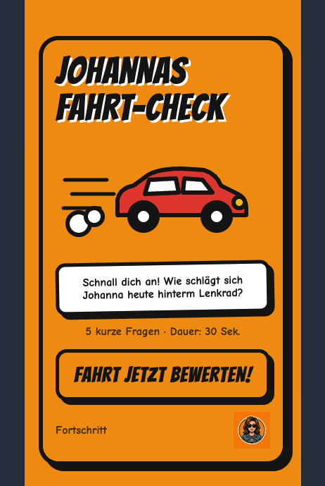

# Johannas Fahrt-Check 🚗

Willkommen im Auto! Hier wird Johanna hinterm Lenkrad bewertet. Mitfahrer scannen einen QR-Code, beantworten fünf zufällige Fragen mit 😬 😐 😎 und bekommen ein geheimes Pseudonym wie *Schwarzer Kater* oder *Tanzende Eule*. Johanna sieht die Ergebnisse später in der Auswertung.

<!-- Screenshot hier ablegen, z. B. docs/screenshot.png -->


> Dieses Projekt ist ein privates Familienspaß-Projekt und kein Produkt. Mitfahrer müssen sich nicht anmelden, bekommen kein Cookie und werden nicht benachrichtigt. Die Bewertungen sind anonym.

## Was drin steckt

- **Mitfahrer-Seite `/`**: fünf Fragen, drei Emoji-Stufen, am Ende ein Pseudonym mit Tier-Icon.
- **Startformular `/johanna`**: Johanna startet eine Fahrt (Name, Ziel, Stadt, Kommentar). Die Fahrt ist 15 Minuten lang bewertbar.
- **QR-Seite `/mitfahrer`**: zeigt den QR-Code zur Bewertungsseite, zum Ausdrucken oder Vorzeigen auf dem Handy.
- **Auswertung `/auswertung`**: Dashboard mit Durchschnitten, Top und Flop 5, Fahrtenliste und Detailansicht.

## Technik

- [Nuxt 4](https://nuxt.com) mit Nitro-Preset `cloudflare_module`
- [Cloudflare Workers](https://developers.cloudflare.com/workers/) für Hosting
- [Cloudflare D1](https://developers.cloudflare.com/d1/) als Datenbank (SQLite)
- [qrcode](https://www.npmjs.com/package/qrcode) für den QR-Code im Browser
- Fragenpool in `server/data/questions.json`, Pseudonyme in `server/data/pseudonyms.json`

## Lokal starten

```bash
npm install
npm run dev
```

Danach läuft die Seite unter `http://localhost:3000` mit Hot Reload. Wrangler ist
bereits installiert; Nuxt nutzt darüber die lokale D1-Datenbank. Die Migrationen
werden beim Start automatisch angewendet. Die lokale Datenbank ist von der
Live-Datenbank getrennt und bleibt unter `.wrangler/state/v3` erhalten.

- `/johanna`, `/mitfahrer` und `/auswertung` sind ohne Login zugänglich.
- Auf `/` kann jederzeit eine Fahrt bewertet werden. Wenn keine Fahrt aktiv ist,
  wird automatisch eine Dummy-Fahrt angelegt oder erneut aktiviert.
- Dummy-Bewertungen werden wirklich lokal gespeichert und erscheinen in der
  Auswertung. Von dort lässt sich auch die Fahrt-Detailansicht öffnen.
- Echte Fahrten lassen sich weiterhin über `/johanna` starten.

Die Login-Freigabe und die Dummy-Fahrt gelten nur im Nuxt-Entwicklungsserver
(`import.meta.dev`), nicht im Produktionsbuild. Ein lokales Passwort ist für
`npm run dev` nicht nötig.

### Produktionsnah lokal testen

`npm run dev:cf` baut die Anwendung und startet sie unter `http://localhost:8787`
direkt in Wrangler, ohne Hot Reload und ohne Entwicklungsfreigaben. Hier gelten
Login und die normale 15-Minuten-Fahrt. Zuvor einmal `npm run db:local` ausführen
und für den Login eine Datei `.dev.vars` im Projektordner anlegen:

```dotenv
AUTH_PASSWORD=dein-entwicklungspasswort
```

Die Datei steht in `.gitignore`. Beide lokalen Startvarianten nutzen dieselbe
lokale Datenbank, niemals die Live-Datenbank.

## Deploy

```bash
npx wrangler secret put AUTH_PASSWORD   # einmalig, fragt nach dem Wert
npx wrangler deploy
```

Die Domain ist als Custom Domain in `wrangler.jsonc` eingetragen. Die D1-Datenbank heißt `driver-rating-db`.

## Projektstruktur

```
app/             Seiten und Styles (Nuxt)
  pages/         Mitfahrer, Startformular, QR-Seite, Auswertung
  assets/css/    Styles im Comic-Look
public/art/      Grafiken: Auto, Tiere, Avatar, Sprechblase
server/
  api/           Endpunkte für Bewertungen, Startformular und Auswertung
  data/          Fragenpool und Pseudonyme
  utils/         Login, Datenbank, Fahrten
migrations/      D1-Schema
issues/          Planungstickets (Markdown, lokal)
design/          Gemini-Vorlagen und Entscheidung zum Stil
prototype/       HTML-Prototyp der ersten Screens
```

## Planung

Die Entstehung ist in `issues/` dokumentiert, angefangen bei der Karte `0001-karte-driver-rating.md`. Dort steht, warum was so gebaut wurde, zum Beispiel warum es keinen Mitfahrer-Code gibt und warum der Login ohne Rate-Limit auskommt.

## Lizenz

Keine. Das Repo ist privat gedacht, wenn du es trotzdem nutzen willst, frag einfach nach. 🙂
